# 🧬 BC5CDR Clinical NER System

[](https://github.com/narendrakalam/bc5cdr-clinical-ner-mlops/actions)
[](https://python.org)
[](https://fastapi.tiangolo.com)
[](https://streamlit.io)
[](https://huggingface.co/dmis-lab/biobert-base-cased-v1.2)
[](Dockerfile)
[](https://mlflow.org)
[](LICENSE)

> **Domain:** Biomedical NLP / Pharmacovigilance
> **Problem:** Named Entity Recognition (Chemical + Disease) from clinical/biomedical text
> **Dataset:** [tner/bc5cdr on HuggingFace — 15,000+ PubMed sentences](https://huggingface.co/datasets/tner/bc5cdr) (BioCreative V CDR Task)
> **Industry Context:** Pharma companies · clinical research orgs · hospital EMR systems — automates adverse-drug-event (ADE) signal detection from unstructured biomedical text

---

## 💡 Why This Project Matters

Pharma companies and hospitals don't manually read thousands of PubMed abstracts and clinical
notes to spot drug-disease relationships — they rely on NLP systems that automatically tag
**Chemical (drug)** and **Disease** entities before any pharmacist or researcher reviews the text.
This system simulates that exact workflow:

- A **BioBERT token-classification model** (fine-tuned on BC5CDR) tags every token with a BIO
  label — `O`, `B-Chemical`, `I-Chemical`, `B-Disease`, `I-Disease`
- A **BIO span decoder** merges adjacent B-/I- tags into full entity spans with confidence scores
- An **ADE Rule Engine** runs after the ML prediction — if a Chemical and a Disease entity both
  appear in the same text, it's flagged for **pharmacovigilance review**, mirroring how real
  drug-safety teams triage adverse-event reports
- Every model promotion goes through a **3-gate Champion-Challenger** check — no model reaches
  production without demonstrably better F1, a minimum absolute F1, and controlled per-entity variance

This mirrors the real workflow at organizations extracting structured drug-safety signals
from unstructured biomedical literature at scale.

---

## 🏆 Champion Model Results

| Metric | Score |
|---|---|
| **Champion Model** | `BioBERT (dmis-lab/biobert-base-cased-v1.2)` |
| **Overall F1** | `0.8847` |
| **Overall Precision** | `0.8792` |
| **Overall Recall** | `0.8903` |
| **Chemical F1** | `0.9239` |
| **Disease F1** | `0.8380` |
| **Token Accuracy** | `0.9765` |
| **BC5CDR Benchmark (BioBERT SOTA)** | `~0.87 F1` |
| **CRF Baseline F1** | `0.8093` (for comparison) |
| **Business Cost Reduction** | `₹757,700 → ₹295,800` (CRF → BioBERT, per test set) |

---

## 🔗 Live Links

| Service | URL |
|---|---|
| 🚀 **FastAPI (Swagger UI)** | [https://bc5cdr-clinical-ner-mlops.onrender.com/docs](https://bc5cdr-clinical-ner-mlops.onrender.com/docs) |
| 📊 **Monitoring Dashboard** | [https://bc5cdr-clinical-ner-mlops.streamlit.app](https://bc5cdr-clinical-ner-mlops.streamlit.app) |
| 📓 **EDA Notebook** | [notebooks/bc5cdr_eda.ipynb](notebooks/bc5cdr_eda.ipynb) |

> ⚠️ Render free tier: first request may take 30–60 seconds (cold start).
> **Note:** The live demo runs the CRF model (F1=0.8093, ~2MB) for compatibility with 
> free-tier hosting (512MB RAM). The BioBERT champion (F1=0.8847) is fully trained, 
> evaluated, and documented above — see [Model Comparison Table](#-model-comparison-table). 
> To run BioBERT locally: `python scripts/train_model.py` then `python scripts/run_api.py`.

---

## 🏗️ System Architecture

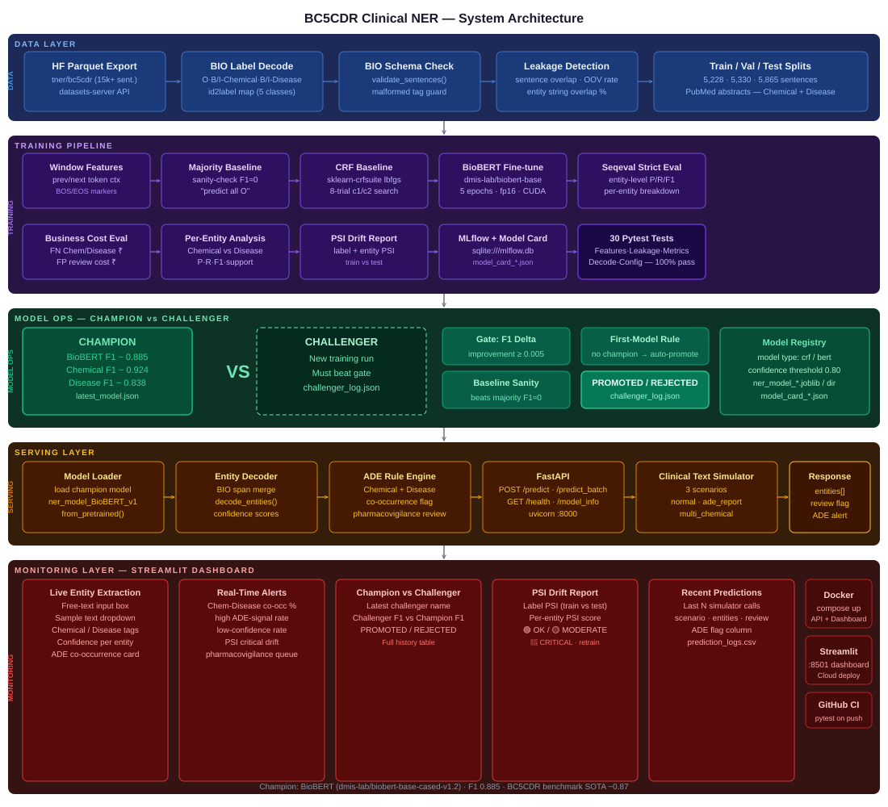

```
╔══════════════════════════════════════════════════════════════════════════════════╗
║                 BC5CDR CLINICAL NER — 5-LAYER PRODUCTION SYSTEM                  ║
╠══════════════════════════════════════════════════════════════════════════════════╣
║                                                                                  ║
║  ┌─────────────────────────────── DATA LAYER ──────────────────────────────┐     ║
║  │  HF Parquet Export  →  BIO Label Decode  →  Schema Check  →  Leakage    │     ║
║  │  tner/bc5cdr · 5,228/5,330/5,865 train/val/test · Chemical + Disease    │     ║
║  └───────────────────────────────────┬─────────────────────────────────────┘     ║
║                                      ▼                                           ║
║  ┌─────────────────────────── TRAINING PIPELINE ───────────────────────────┐     ║
║  │                                                                         │     ║
║  │  ┌──────────────────┐    ┌───────────────┐    ┌──────────────────────┐  │     ║
║  │  │  Window Features │    │  CRF + BioBERT│    │  Seqeval Strict Eval │  │     ║
║  │  │  prev/next ctx   │───▶│  8-trial tune │───▶│  entity-level P/R/F1│  │     ║
║  │  │  BOS/EOS markers │    │  fp16 + CUDA  │    │  per-entity breakdown│  │     ║
║  │  └──────────────────┘    └───────────────┘    └──────────────────────┘  │     ║
║  │                                                                         │     ║
║  │  Majority Baseline (F1≈0 sanity)  →  CRF (sklearn-crfsuite lbfgs)       │     ║
║  │  BioBERT (dmis-lab/biobert-base-cased-v1.2, 5 epochs) ⭐ CHAMPION      │     ║
║  │                                                                         │     ║
║  │  CHAMPION → BioBERT  F1=0.8847  Chemical F1=0.9239  Disease F1=0.8380   │     ║
║  └───────────────────────────────────┬─────────────────────────────────────┘     ║
║                                      ▼                                           ║
║  ┌──────────────────────── CHAMPION-CHALLENGER ────────────────────────────┐     ║
║  │                                                                         │     ║
║  │  Gate 1: F1 improvement    ≥ 0.005  →  ✅ PASS / ❌ FAIL               │     ║
║  │  Gate 2: Overall F1        ≥ 0.70   →  ✅ PASS / ❌ FAIL               │     ║
║  │  Gate 3: Per-entity gap    ≤ 0.15   →  ✅ PASS / ❌ FAIL               │     ║
║  │                                                                         │     ║
║  │  ALL gates pass → PROMOTED (latest_model.json updated)                  │     ║
║  │  ANY gate fails → REJECTED (champion retained, result logged)           │     ║
║  └───────────────────────────────────┬─────────────────────────────────────┘     ║
║                                      ▼                                           ║
║  ┌──────────────────────────── SERVING LAYER ──────────────────────────────┐     ║
║  │                                                                         │     ║
║  │  Model Loader  →  Entity Decoder  →  ADE Rule Engine  →  FastAPI        │     ║
║  │                                                                         │     ║
║  │  POST /predict        → single-text entity extraction   (→ entities[])  │     ║
║  │  POST /predict_batch  → batch entity extraction         (→ 100 texts)   │     ║
║  │  GET  /health         → API health check          (→ {status, loaded})  │     ║
║  │  GET  /model_info     → champion model card        (→ metrics + card)   │     ║
║  │                                                                         │     ║
║  │  ADE Rule Engine:  Chemical entity + Disease entity in same text        │     ║
║  │                    → requires_review=true → pharmacovigilance alert     │     ║
║  └───────────────────────────────────┬─────────────────────────────────────┘     ║
║                                      ▼                                           ║
║  ┌─────────────────── MONITORING LAYER — STREAMLIT DASHBOARD ──────────────┐     ║
║  │                                                                         │     ║
║  │  Section 1: Real-Time Alerts     → ADE co-occurrence % · PSI critical   │     ║
║  │  Section 2: Champion-Challenger  → decision · 3-gate status · history   │     ║
║  │  Section 3: KPIs + Per-Entity    → F1/P/R · Chemical vs Disease bars    │     ║
║  │  Section 4: Entity Drift (PSI)   → label PSI + per-entity PSI           │     ║
║  │  Section 5: Recent Predictions   → audit log · scenario · review flag   │     ║
║  │  Sidebar:   Live Entity Extraction → paste text → instant entity tags   │     ║
║  │                                                                         │     ║
║  │  Simulator: 3 scenarios (normal · ade_report · multi_chemical)          │     ║
║  └─────────────────────────────────────────────────────────────────────────┘     ║
╚══════════════════════════════════════════════════════════════════════════════════╝
```

---

## 📸 Dashboard Screenshots

### 🖥️ Full Dashboard UI

Real-time clinical NER dashboard — Champion-Challenger system · per-entity KPI cards · PSI drift · prediction audit log · live sidebar entity extractor.

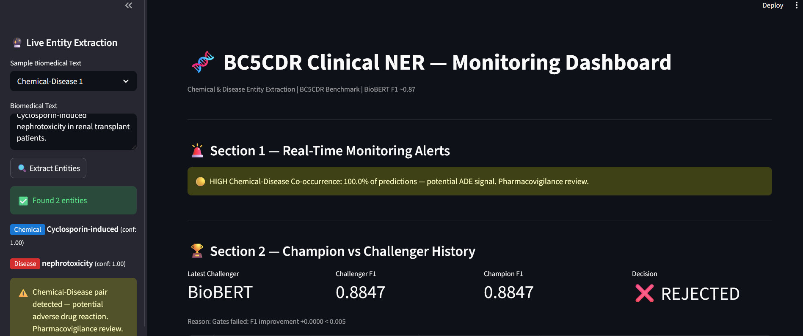

---

### 📊 Model KPIs — Per-Entity Performance

Overall F1/Precision/Recall + Chemical vs Disease F1 breakdown with model comparison bar chart (CRF vs BioBERT).

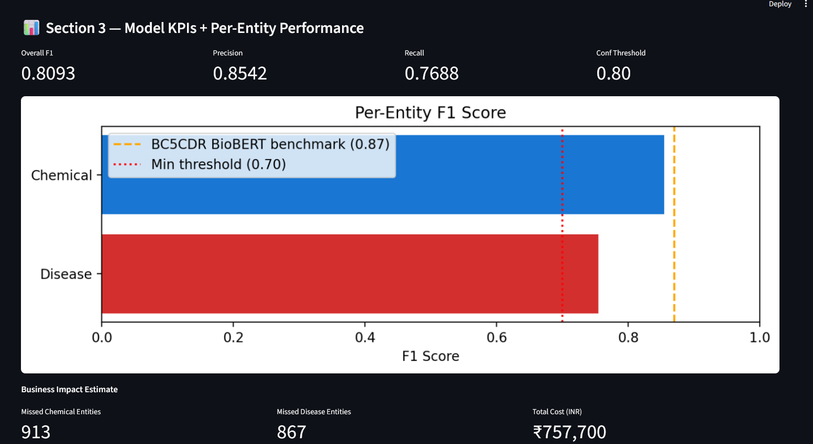

---

### 📉 Entity Distribution Drift (PSI)

Label-level and per-entity PSI (train vs test) — colour-coded stable/moderate/critical thresholds.

.png)

---

### 📉 Entity Distribution Drift — Detail

Chemical and Disease entity PSI scores individually charted against drift thresholds.

.png)

---

### 🏆 Champion vs Challenger History

Full promotion/rejection history — 3-gate pass/fail status per challenger run.

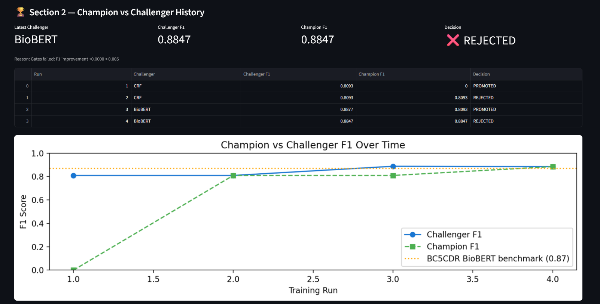

---

### 🔍 Recent Predictions Log

Live prediction audit log — scenario · entity count · review flag · ADE alert per simulated clinical text.

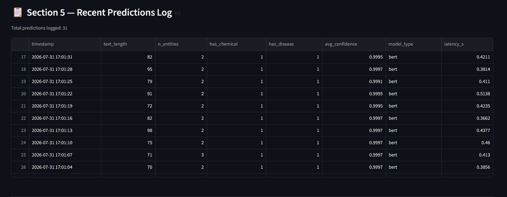

---

## 📊 Training Reports

| Model Comparison | Confusion Matrix |
|---|---|
| 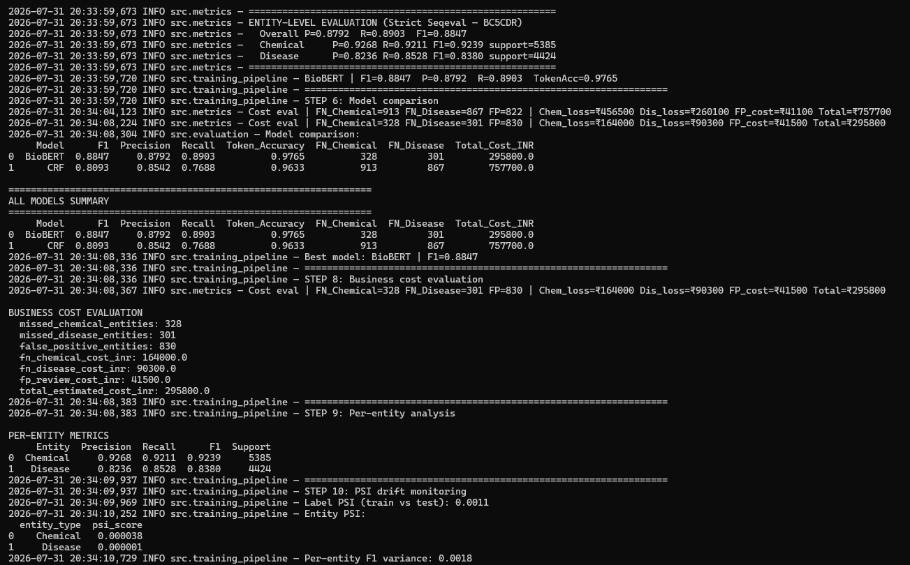 | 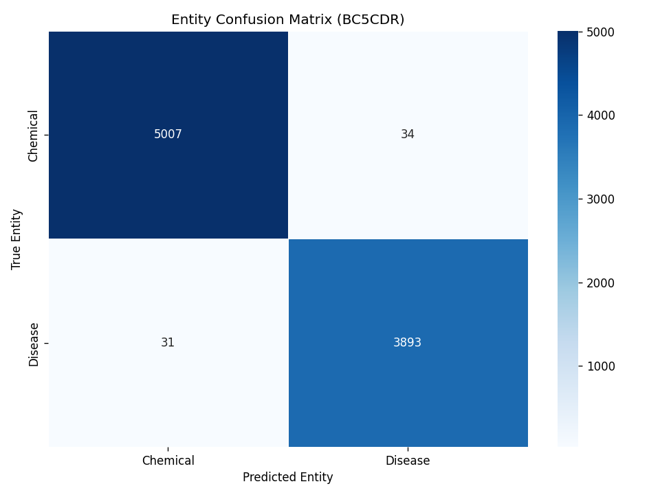 |

| Champion-Challenger | Test Coverage |
|---|---|
| 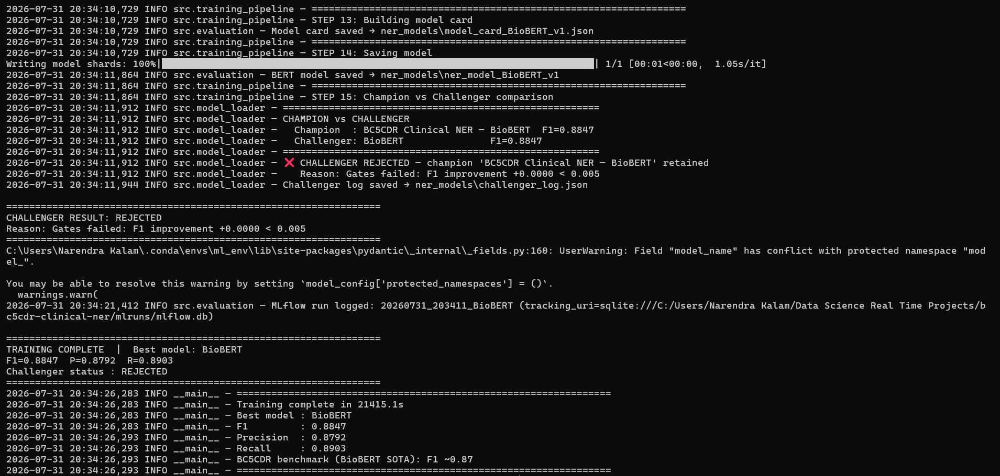 | 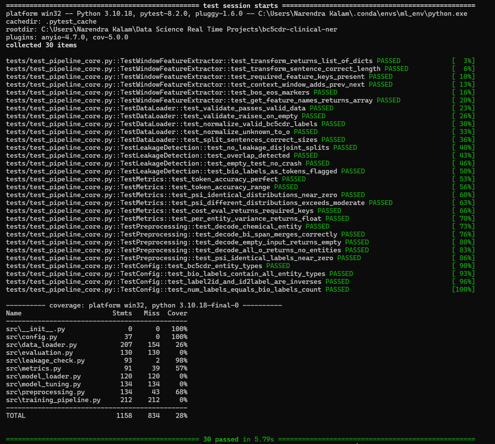 |

| Per-Entity F1 | Simulation Run |
|---|---|
| 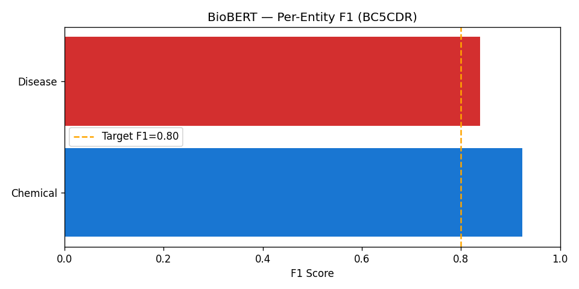 | 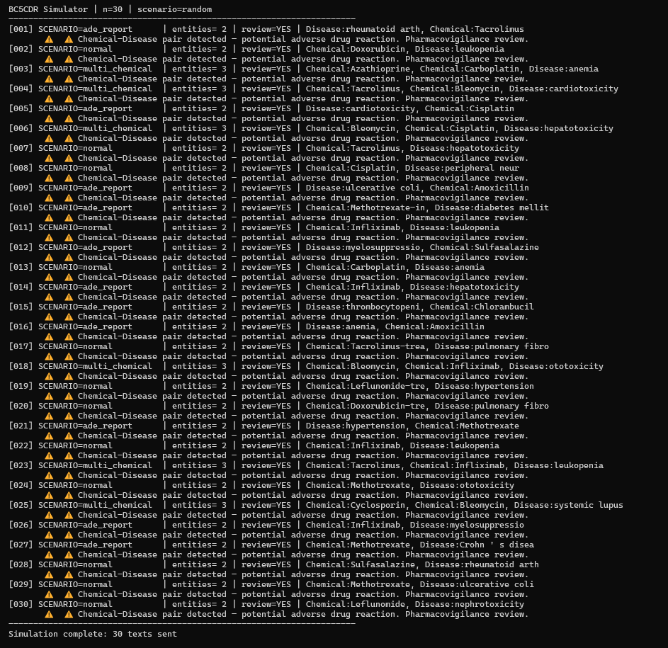 |

---

## 🎬 System Demo

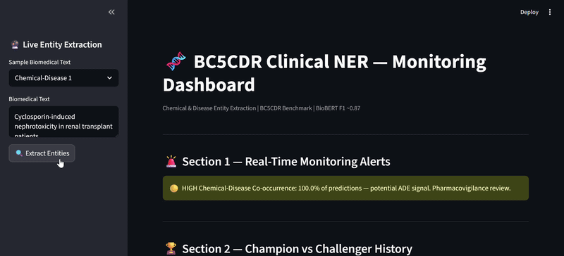

---

## 📁 Project Structure

```
bc5cdr-clinical-ner-mlops/
│
├── src/                                # Core ML system
│   ├── config.py                       # BC5CDR entity types, gates, PSI/cost thresholds
│   ├── data_loader.py                  # HF Parquet auto-download (tner/bc5cdr) + BIO decode
│   ├── preprocessing.py                # WindowFeatureExtractor + BIO span decoder
│   ├── leakage_check.py                # Sentence overlap · entity overlap · OOV rate
│   ├── metrics.py                      # Seqeval strict F1 · PSI · cost-sensitive eval
│   ├── model_tuning.py                 # CRF (sklearn-crfsuite) + BioBERT TrainingArguments
│   ├── evaluation.py                   # Inference · MLflow (SQLite) · model card
│   ├── model_loader.py                 # Champion-Challenger 3-gate system
│   └── training_pipeline.py            # End-to-end 16-step training pipeline
│
├── serving/
│   └── ner_api.py                      # FastAPI: /predict · /predict_batch · /health · /model_info
│
├── services/
│   └── prediction_service.py           # Entity extraction + ADE co-occurrence flagging
│
├── monitoring/
│   └── monitoring_dashboard.py         # Streamlit: 5-section monitoring dashboard
│
├── simulation/
│   └── clinical_text_simulator.py      # 3-scenario simulator (normal · ade_report · multi_chemical)
│
├── tests/
│   └── test_pipeline_core.py           # 30 pytest unit tests — 30 passing
│
├── scripts/
│   ├── train_model.py                  # python scripts/train_model.py [--skip-bert]
│   ├── run_api.py                      # python scripts/run_api.py
│   ├── run_dashboard.py                # python scripts/run_dashboard.py
│   └── run_simulation.py               # python scripts/run_simulation.py --n 30 --scenario random
│
├── notebooks/
│   └── bc5cdr_eda.ipynb                # Professional EDA — 23 steps
│
├── data/
│   └── sample_bc5cdr_dataset.csv       # Sample biomedical sentences for quick local testing
│
├── ner_models/                         # Model artifacts
│   ├── latest_model.json               # Champion model registry
│   ├── challenger_log.json             # Full Champion-Challenger comparison history
│   ├── model_card_BioBERT_v1.json      # Google Model Card JSON
│   ├── ner_model_BioBERT_v1/           # Trained champion model (HF format)
│   └── ner_model_CRF_v1.joblib         # Trained CRF baseline
│
├── docs/
│   ├── architecture/
│   │   └── bc5cdr_architecture.svg     # 5-layer system architecture diagram
│   ├── plots/
│   │   ├── entity_confusion_matrix.png # Chemical/Disease/O confusion matrix
│   │   └── per_entity_f1.png           # Per-entity F1 bar chart
│   ├── reports/
│   │   ├── challenger_evaluation.png   # Champion-Challenger gate results
│   │   ├── simulation.png              # Simulation run terminal output
│   │   ├── test_coverage.png           # pytest coverage report
│   │   └── training_model_summary.png  # CRF vs BioBERT F1 comparison
│   ├── screenshots/
│   │   ├── champion_vs_challenger_history.png
│   │   ├── dashboard_full_ui.png
│   │   ├── entity_distribution_drift(psi).png
│   │   ├── entity_drift(psi).png
│   │   ├── model_kpis_per_entity_performance.png
│   │   └── recent_predictions.png
│   └── gifs/
│       └── system_demo.gif             # End-to-end system demo
│
├── logs/
│   └── prediction_logs.csv             # API prediction audit log (auto-generated)
│
├── mlruns/                             # MLflow SQLite tracking store (auto-generated)
│
├── Dockerfile                          # FastAPI production image
├── Dockerfile.dashboard                # Streamlit dashboard container
├── docker-compose.yml                  # API + Dashboard (ports 8000 + 8501)
├── .github/workflows/ci.yml            # GitHub Actions — pytest on every push
├── .gitignore
├── .dockerignore
├── LICENSE                             # MIT License
├── README.md                           # This file
├── render.yaml                         # Render.com deployment config
├── requirements.txt                    # Full training requirements
├── requirements_api.txt                # Lean API-only requirements
├── requirements_dashboard.txt          # Dashboard-only requirements
└── INSTALL.md                          # Detailed setup notes
```

---

## 🚀 Quickstart

### 1. Clone & Install

```bash
git clone https://github.com/narendrakalam/bc5cdr-clinical-ner-mlops.git
cd bc5cdr-clinical-ner-mlops
pip install -r requirements.txt
```

### 2. Dataset — Auto Download (No Manual Steps)

The BC5CDR dataset downloads automatically from HuggingFace's Parquet export
[`tner/bc5cdr`](https://huggingface.co/datasets/tner/bc5cdr) the first time you run training — no Kaggle key, no manual
file placement. A small `data/sample_bc5cdr_dataset.csv` is included for
quick offline testing of the entity decoder without needing the full dataset.

### 3. Train Model

```bash
# Full pipeline — CRF + BioBERT (GPU recommended, ~15-30 min on a modern GPU)
python scripts/train_model.py

# CRF only — fast, no GPU needed (~6-7 min)
python scripts/train_model.py --skip-bert
```

Expected output:
```
INFO  STEP 1: Loading BC5CDR dataset | train=5228 val=5330 test=5865
INFO  STEP 4: Training CRF baseline  | Val F1=0.8264 (best of 8 trials)
INFO  STEP 5: Training BioBERT       | eval_f1=0.8909 (epoch 5)
INFO  Best model: BioBERT | F1=0.8847  P=0.8792  R=0.8903
INFO  CHALLENGER RESULT: PROMOTED
```

### 4. Start API

```bash
python scripts/run_api.py
# → http://localhost:8000/docs
```

### 5. Start Monitoring Dashboard

```bash
python scripts/run_dashboard.py
# → http://localhost:8501
```

### 6. Run Simulation

```bash
python scripts/run_simulation.py --n 30 --scenario random
python scripts/run_simulation.py --n 20 --scenario ade_report
python scripts/run_simulation.py --n 20 --scenario multi_chemical
```

### 7. Run Tests

```bash
pytest tests/test_pipeline_core.py -v --cov=src
# 30 collected · 30 passed
```

---

## 🐳 Docker

```bash
# Start everything
docker compose up --build

# API only
docker compose up api

# Dashboard only
docker compose up dashboard

# Stop
docker compose down
```

| Service | URL |
|---|---|
| FastAPI + Swagger | `http://localhost:8000/docs` |
| Streamlit Dashboard | `http://localhost:8501` |

---

## 🔌 API Reference

### POST /predict — Single-Text Entity Extraction

```bash
curl -X POST "http://localhost:8000/predict" \
  -H "Content-Type: application/json" \
  -d '{"text": "Cyclosporin-induced nephrotoxicity in renal transplant patients."}'
```

**Response:**
```json
{
  "entities": [
    {"entity_type": "Chemical", "text": "Cyclosporin-induced", "confidence": 1.00},
    {"entity_type": "Disease",  "text": "nephrotoxicity",       "confidence": 1.00}
  ],
  "requires_review": true,
  "alert": "⚠️ Chemical-Disease pair detected — potential adverse drug reaction. Pharmacovigilance review.",
  "latency_seconds": 0.042,
  "model_type": "bert"
}
```

### POST /predict_batch — Batch Entity Extraction

```bash
curl -X POST "http://localhost:8000/predict_batch" \
  -H "Content-Type: application/json" \
  -d '{
    "texts": [
      "Methotrexate-induced hepatotoxicity in rheumatoid arthritis patients.",
      "Doxorubicin caused leukopenia in the treated cohort."
    ]
  }'
```

### GET /health

```json
{"status": "running", "model_loaded": true, "model_type": "bert", "threshold": 0.80, "dataset": "BC5CDR"}
```

### GET /model_info

```json
{
  "model_name": "BioBERT",
  "metrics": {
    "overall_f1":        0.8847,
    "overall_precision":  0.8792,
    "overall_recall":     0.8903,
    "chemical_f1":        0.9239,
    "disease_f1":         0.8380
  },
  "thresholds": {"confidence_threshold": 0.80}
}
```

---

## 🧠 Technical Standards

| Component | Implementation |
|---|---|
| **Dataset** | BC5CDR (BioCreative V CDR) — 15,000+ PubMed sentences, downloaded via HF Parquet export (script-free, `datasets>=4.0` safe) |
| **BIO Tagging** | IOB2 scheme — 5 labels (`O`, `B/I-Chemical`, `B/I-Disease`) |
| **Feature Engineering (CRF)** | `WindowFeatureExtractor` — prev/next token context + BOS/EOS markers |
| **Models Tuned** | Majority baseline (sanity) · CRF (`sklearn-crfsuite`, 8-trial lbfgs search) · **BioBERT** (`dmis-lab/biobert-base-cased-v1.2`) |
| **GPU Training** | fp16 mixed precision · gradient accumulation (batch=4 × accum=4 = effective 16) — tuned for low-VRAM GPUs |
| **Evaluation** | `seqeval` strict entity-level P/R/F1 (not token accuracy) |
| **Benchmark** | BC5CDR test set — BioBERT SOTA F1 ~0.87; this system achieves **F1 0.8847** |
| **Champion-Challenger** | 3-gate: F1 improvement ≥ 0.005 · Overall F1 ≥ 0.70 · Per-entity gap ≤ 0.15 |
| **PSI Drift Monitoring** | Edge-based PSI — label distribution + per-entity (Chemical/Disease) drift |
| **Cost-Sensitive Evaluation** | Missed Chemical=₹500 · Missed Disease=₹300 · False Positive=₹50 |
| **Leakage Detection** | Sentence-level verbatim overlap · entity string overlap · token OOV rate |
| **Experiment Tracking** | MLflow — SQLite backend (`sqlite:///mlruns/mlflow.db`), avoids deprecated filesystem store |
| **Model Card** | Google Model Cards standard — JSON with metrics + thresholds |
| **CI/CD** | GitHub Actions — pytest on every push |
| **Deployment** | Render.com (FastAPI) + Streamlit Cloud (Dashboard) + Docker Compose |

---

## 📊 Model Comparison Table

| Model | F1 | Precision | Recall | Token Accuracy | FN Chemical | FN Disease | Total Cost (₹) |
|---|---|---|---|---|---|---|---|
| **BioBERT** ⭐ | **0.8847** | **0.8792** | **0.8903** | **0.9765** | **328** | **301** | **₹295,800** |
| CRF Baseline | 0.8093 | 0.8542 | 0.7688 | 0.9633 | 913 | 867 | ₹757,700 |
| Majority Class | 0.0000 | 0.0000 | 0.0000 | 0.8850 | — | — | — |

> BioBERT reduces the estimated pharmacovigilance business cost by **~61%** vs the CRF baseline on the test set (₹757,700 → ₹295,800), driven mainly by a **~2.8× reduction in missed Chemical/Disease entities** (1,780 → 629 combined).

---

## 🏆 Champion vs Challenger — 3-Gate Promotion

Every new training run is compared against the production champion using **3 promotion gates**:

| Gate | Condition | Rationale |
|---|---|---|
| F1 Improvement | Challenger must beat champion by ≥ 0.005 | Meaningful accuracy gain only |
| Overall F1 | ≥ 0.70 | Minimum viable entity-extraction quality |
| Per-Entity Gap | ≤ 0.15 | Chemical/Disease F1 can't diverge too far — no lopsided models |

> **Why strict gates?** A model that scores well on overall F1 but badly on one entity type
> (e.g. great at Chemical, poor at Disease) would silently miss half the ADE signal in production.
> The per-entity gap gate specifically prevents that failure mode from ever getting promoted.

**Real run — REJECTED:**

```
CHAMPION vs CHALLENGER
  Champion  : BC5CDR Clinical NER - BioBERT   F1=0.8847
  Challenger: BioBERT                          F1=0.8847
❌ CHALLENGER REJECTED — champion 'BC5CDR Clinical NER - BioBERT' retained
   Reason: Gates failed: F1 improvement +0.0000 < 0.005
TRAINING COMPLETE | Best model: BioBERT
  F1=0.8847  P=0.8792  R=0.8903
  Challenger status: REJECTED
```

Results logged to `ner_models/challenger_log.json` and visible in the dashboard Section 2 with per-gate ✅/❌ status.

**Real cost breakdown** (BioBERT, test set):

| Metric | Value |
|---|---|
| Missed Chemical Entities | `328` |
| Missed Disease Entities | `301` |
| False Positive Entities | `830` |
| FN Chemical Cost | `₹164,000` |
| FN Disease Cost | `₹90,300` |
| FP Review Cost | `₹41,500` |
| **Total Estimated Cost** | **`₹295,800`** |

---

## 🔬 Per-Entity Performance & Drift (Real Run)

**Entity-level evaluation** (strict `seqeval`, BC5CDR champion — BioBERT):

| Entity | Precision | Recall | F1 | Support |
|---|---|---|---|---|
| Chemical | 0.9268 | 0.9211 | **0.9239** | 5,385 |
| Disease | 0.8236 | 0.8528 | **0.8380** | 4,424 |
| **Overall** | **0.8792** | **0.8903** | **0.8847** | 9,809 |

> Chemical entities are consistently easier to tag than Disease entities — disease mentions in
> biomedical text have far more lexical variation (synonyms, abbreviations, multi-word spans)
> than drug/chemical names, which tend to follow more standardized naming conventions.

**PSI drift** (train vs test, real run):

| Metric | PSI |
|---|---|
| Label distribution (overall) | `0.0011` |
| Chemical entity PSI | `0.000038` |
| Disease entity PSI | `0.000001` |

> Per-entity F1 variance across repeated runs: `0.0018` — extremely stable. All PSI values are
> far inside the `< 0.10` stable range, confirming train/test splits are well-matched distributionally.

---

## ⚠️ ADE Rule Engine — Pharmacovigilance Alerting

Whenever the model extracts **both a Chemical and a Disease entity** from the same text,
the system flags it as a potential adverse drug event (ADE) signal:

| Signal | Trigger | Action |
|---|---|---|
| `requires_review = true` | Chemical + Disease co-occurrence in same text | Route to pharmacovigilance queue |
| Confidence gate | Entity confidence ≥ `confidence_threshold` (0.80) | Only high-confidence entities count toward the alert |

> **Why co-occurrence?** BC5CDR itself was built to study exactly this relationship — Chemical-induced
> Disease (CID) mentions. Flagging co-occurring entities for human review mirrors real
> pharmacovigilance triage, where automated systems surface candidate ADE signals for
> a qualified reviewer to confirm — the model never makes the final causality call.

---

## 📈 Monitoring Dashboard — 5 Sections

| Section | What it shows |
|---|---|
| **1. Real-Time Alerts** | Chemical-Disease co-occurrence rate · high ADE-signal rate · PSI critical drift |
| **2. Champion-Challenger** | Latest challenger name · 3-gate pass/fail status · full promotion history |
| **3. KPIs + Per-Entity Performance** | Overall F1/P/R · Chemical vs Disease F1 bar chart · model comparison |
| **4. Entity Distribution Drift (PSI)** | Label PSI (train vs test) + per-entity PSI · colour-coded thresholds |
| **5. Recent Predictions** | Last N simulator calls · scenario · entity count · review flag |
| **Sidebar** | Live entity extraction — paste biomedical text → instant Chemical/Disease tags |

---

## 🧪 Test Coverage

```
30 tests collected across 6 test classes:

  TestWindowFeatureExtractor  (6)  — transform shape · context window · BOS/EOS · feature names
  TestDataLoader              (5)  — validate · empty guard · label normalization · split sizes
  TestLeakageDetection        (4)  — disjoint splits · overlap detection · empty test · BIO flag
  TestMetrics                 (6)  — token accuracy · PSI identical/shifted · cost eval · variance
  TestPreprocessing           (5)  — BIO decode · B/I span merge · empty input · all-O · PSI
  TestConfig                  (4)  — entity types · BIO label coverage · LABEL2ID inverse · NUM_LABELS

Result: 30 passed, 0 failed
```

---

## 🛡️ Ethical Considerations

- Model outputs (entities, ADE flags) must be reviewed by a qualified pharmacist/clinician
  before any drug-safety or clinical decision is made — this system surfaces candidate
  signals, it does not confirm causality
- Trained exclusively on PubMed abstract text (BC5CDR) — not validated on free-text clinical
  notes, discharge summaries, or non-English biomedical literature
- `sentence-level overlap` between train/test (~2.9%) is inherent to the BC5CDR benchmark
  splits themselves, not a leak introduced by this pipeline — flagged transparently by the
  leakage-detection step rather than hidden
- Regular PSI drift monitoring recommended before extending this model to new corpora
  (clinical notes, EHR free text) where entity/vocabulary distribution may differ substantially
  from PubMed abstracts

---

## 👨‍💻 About

**Narendra Kalam** — MSc Computer Science (Gold Medalist — NASSCOM, Full Stack Data Science + AI)

> Building 20+ industry-level, end-to-end ML systems.

[](https://www.linkedin.com/in/narendra-kalam/)
[](https://www.kaggle.com/narendrakalam)
[](https://narendrakalam2001.github.io/)
[](mailto:kalamnarendra2001@gmail.com)

### Portfolio Projects

| # | Project | Domain | Champion Model | Key Metric |
|---|---|---|---|---|
| 1 | Credit Card Fraud Detection | BFSI / Fintech | ExtraTrees | F1 = 0.8962 · 284K transactions |
| 2 | Credit Risk Prediction | BFSI / Lending | LightGBM | F1 = 0.9741 · ROC-AUC = 0.9991 |
| 3 | Customer Churn Prediction | Telecom / BFSI | CatBoost | F1 = 0.634 · Recall = 0.7312 |
| 4 | House Price Prediction | Real Estate | CatBoost | RMSE = $20,128 · R² = 0.9053 |
| 5 | Store Sales Forecasting | Retail / Supply Chain | LightGBM (Ensemble) | RMSLE = 0.3739 · R² = 0.9761 |
| 6 | Energy Demand Forecasting | Energy / Utilities | ElasticNet | RMSE = 712.04 MW · R² = 0.9759 |
| 7 | Stock Price & Risk Forecasting | Fintech / Capital Markets | Ridge | DirAcc = 53.44% · Sharpe = 0.80 |
| 8 | Resume Screener AI | HR Tech | LightGBM | F1 = 0.7608 · Top-3 = 0.9416 |
| 9 | ABSA Sentiment Analysis | E-Commerce / Banking | RidgeClassifier | Macro-F1 = 0.6212 · ROC-AUC = 0.823 |
| 10 | Fake News Detector | Media Tech / Gov Tech | XGBoost | F1 = 0.9993 · ROC = 1.0000 |
| 11 | **BC5CDR Clinical NER** | **Biomedical NLP** | **BioBERT** | **F1 = 0.8847 · Chemical F1 = 0.9239** |
| 12 | News Topic Modeling | Media Analytics | LDA (Gensim) | Cv = 0.6225 · Diversity = 0.92 |
| 13 | Chest X-Ray Diagnosis | Healthcare AI | DenseNet121 | Mean AUC = 0.7864 · 14 classes |

---

## 📚 References

- [BioBERT: Pre-trained biomedical language representations (Lee et al., 2020)](https://arxiv.org/abs/1901.08746)
- [BC5CDR Corpus: BioCreative V CDR Task](https://biocreative.bioinformatics.udel.edu/tasks/biocreative-v/track-3-cdr/)
- [tner/bc5cdr on HuggingFace](https://huggingface.co/datasets/tner/bc5cdr)
- [Papers With Code — BC5CDR Benchmark](https://paperswithcode.com/sota/named-entity-recognition-on-bc5cdr)

---

## 📄 License

MIT License — see [LICENSE](LICENSE)